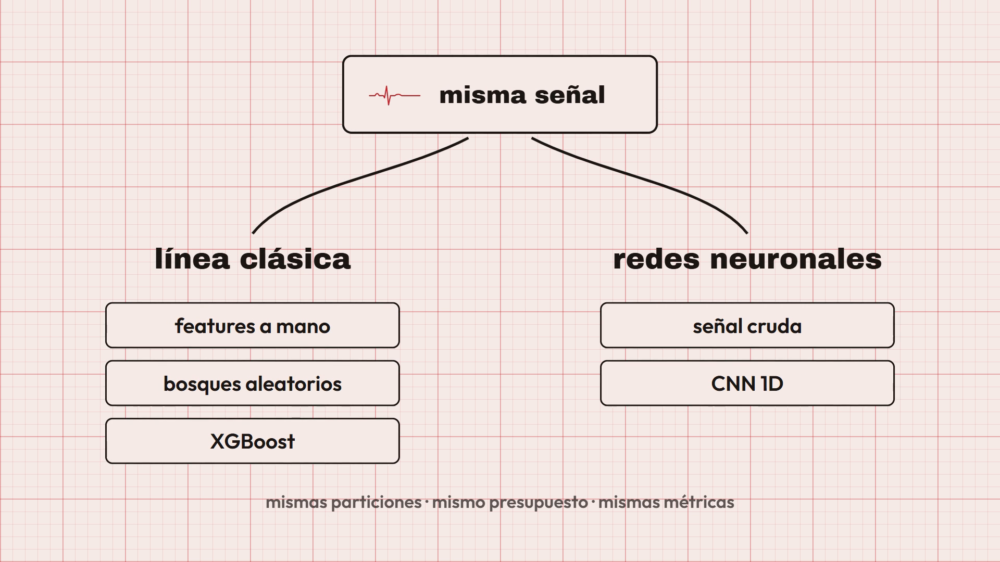

# Clasificación de ECG con PTB-XL — Proyecto final TAIA (Grupo 9)

Maestría en IA, Universidad de La Sabana.

Repositorio de trabajo privado: https://github.com/AlejoMoncada/taia-proyecto-final,
rama `entrega`. El acceso del equipo requiere invitación; la publicación definitiva queda pendiente de autorización.

Clasificamos electrocardiogramas de 12 derivaciones en las 5 superclases diagnósticas de PTB-XL
(NORM, MI, STTC, CD, HYP). Es un problema **multietiqueta**: un mismo ECG puede tener, por ejemplo,
infarto (MI) y alteraciones del ST (STTC) a la vez.

## Datos

- **PTB-XL 1.0.3** (PhysioNet), 21.799 ECG de 18.869 pacientes, 10 s por registro. Licencia CC BY 4.0.
- Usamos la versión a 100 Hz (`records100`, ~0,5 GB). El script baja los CSV y esos registros desde el
  mirror oficial de PhysioNet en AWS (`physionet-open`), verifica cada archivo con `SHA256SUMS.txt` y se
  puede reanudar si se corta. El zip de physionet.org pesa 1,8 GB y con nuestra conexión bajaba a ~50 KB/s.
- Los datos no se suben al repo (`data/` está en `.gitignore`).

## Partición sin fuga

PTB-XL trae la columna `strat_fold` (10 folds estratificados) y garantiza que todos los registros de un
paciente caen en el mismo fold. Seguimos la recomendación de los autores:

| Partición | Folds | Uso |
|-----------|-------|-----|
| train | 1–8 | ajuste de modelos, imputador y escalador |
| val   | 9   | selección de hiperparámetros y umbrales |
| test  | 10  | solo para el reporte final |

El código verifica explícitamente que ningún `patient_id` aparezca en dos particiones (`ecg.data.check_no_patient_leakage`).

## Cómo correrlo

Requiere [uv](https://docs.astral.sh/uv/).

```bash
uv sync                                   # instala dependencias (versiones fijadas en uv.lock)
# sin uv: pip install -r requirements.txt --extra-index-url https://download.pytorch.org/whl/cu126
uv run python -m ecg.data                 # descarga PTB-XL, hace el split y cachea las señales
uv run python -m ecg.baseline             # línea base clásica (features + RF / XGBoost)
uv run python -m ecg.tune_xgb             # búsqueda de XGBoost en val + 3 semillas
uv run python -m ecg.deep search --model cnn1d     # búsqueda de la CNN 1D (igual con cnn_lstm)
uv run python -m ecg.deep final --model cnn1d      # mejor configuración con 3 semillas
uv run python -m ecg.deep search --model cnn_lstm  # búsqueda de la CNN+LSTM
uv run python -m ecg.deep final --model cnn_lstm   # mejor configuración con 3 semillas
uv run python -m ecg.bootstrap            # Cálculo de rigor estadístico (Incertidumbre poblacional)
uv run python -m ecg.compare              # tabla y figuras comparativas en outputs/comparison/
uv run pytest                             # pruebas
```

Toda la configuración (semilla, folds, hiperparámetros) está en `configs/default.yaml`.
Para probar otra configuración: `uv run python -m ecg.baseline --config configs/otra.yaml`.

Las cifras reportadas usan `deep.loss: bce` y `deep.temperature_scaling: false`, que son los valores
por defecto. La pérdida focal (`loss: focal`) y el escalado de temperatura ajustado en validación
están implementados como opción, pero no se usaron en los resultados; activarlos cambia las cifras.

## Estructura

```
configs/      configuración en YAML
src/ecg/      código: datos, features, métricas, modelos
tests/        pruebas (split sin fuga, features, métricas, redes, comparación)
docs/         plan, ficha de datos y ficha del modelo
notebooks/    exploración
video/        proyecto del video de sustentación (escenas HTML, locución y render)
outputs/      resultados de cada corrida (métricas, figuras, modelos)
```

## Línea base clásica

Por cada una de las 12 derivaciones se extraen estadísticos de amplitud (media, desviación, percentiles,
asimetría, curtosis, RMS), cruces por cero y potencia en tres bandas de frecuencia (Welch). De la
derivación II se estima la frecuencia cardiaca y la variabilidad RR. Se agregan edad y sexo.
Con eso se entrena un Random Forest y un XGBoost (uno contra el resto por clase).

El umbral de decisión de cada clase se escoge en validación maximizando F1; test no se toca hasta el final.

Resultados en test (fold 10, n = 2.158, semilla 42, CPU AMD de 12 hilos):

| Modelo | F1 macro | ROC-AUC macro | Brier | ECE | Entrenamiento | Inferencia |
|--------|---------:|--------------:|------:|----:|--------------:|-----------:|
| Random Forest | 0,650 | 0,866 | 0,120 | 0,073 | 23 s | 0,12 ms/ECG |
| XGBoost       | 0,690 | 0,890 | 0,105 | 0,048 | 53 s | 0,02 ms/ECG |

F1 por clase con XGBoost: NORM 0,81 · MI 0,64 · STTC 0,71 · CD 0,68 · HYP 0,60. HYP, la clase menos
frecuente (12 %), es la más difícil. La extracción de las 210 features tarda unos 42 s para los 21.388 ECG.

Para medir la variación entre corridas repetimos el entrenamiento con tres semillas (mismas particiones y
features; solo cambia la semilla de los modelos):

```bash
uv run python -m ecg.baseline --seeds 42 43 44
```

| Modelo (test, media ± desv.) | F1 macro | ROC-AUC macro | ECE |
|------------------------------|---------:|--------------:|----:|
| Random Forest | 0,652 ± 0,002 | 0,866 ± 0,001 | 0,073 ± 0,000 |
| XGBoost       | 0,692 ± 0,002 | 0,891 ± 0,001 | 0,049 ± 0,001 |

La diferencia entre XGBoost y Random Forest (unos 4 puntos de F1) es mucho mayor que la variación por
semilla. El detalle por corrida queda en `outputs/baseline/seeds/`.

## Redes profundas y comparación

Dos redes leen las 12 derivaciones en bruto (1.000 muestras), normalizadas por derivación con estadísticas
de train: una CNN 1D residual y una CNN+LSTM (bloques residuales más una LSTM bidireccional). Se entrenan
con AdamW, parada temprana sobre el ROC-AUC macro de val y un tope de 5 minutos por corrida en una
GTX 1660 SUPER.

Para que la comparación sea justa, cada familia (XGBoost, CNN 1D, CNN+LSTM) tiene el mismo presupuesto de
búsqueda: 8 configuraciones aleatorias, elegidas por ROC-AUC macro en val. La mejor se entrena con las
semillas 42, 43 y 44. Test no participa en ninguna elección. El tiempo total no se iguala; se reporta.

| Modelo (test, media ± desv.) | F1 macro | ROC-AUC macro | Brier | ECE | Entrenamiento | Búsqueda |
|------------------------------|---------:|--------------:|------:|----:|--------------:|---------:|
| Random Forest     | 0,652 ± 0,002 | 0,866 ± 0,001 | 0,119 | 0,073 | 19 s  | -       |
| XGBoost por defecto | 0,692 ± 0,002 | 0,891 ± 0,001 | 0,104 | 0,049 | 55 s  | -       |
| XGBoost ajustado  | 0,690 ± 0,004 | 0,894 ± 0,001 | 0,107 | 0,068 | 92 s  | 319 s   |
| CNN 1D            | 0,744 ± 0,005 | 0,927 ± 0,001 | 0,085 | 0,040 | 137 s | 1.454 s |
| CNN+LSTM          | 0,750 ± 0,003 | 0,928 ± 0,001 | 0,084 | 0,039 | 170 s | 1.302 s |

Las redes superan a XGBoost por unos 5 puntos de F1 y 3 de AUC, y además calibran mejor. La ganancia
está sobre todo en MI y CD; en HYP casi no mejoran (F1 ≈ 0,60 en todos). CNN 1D y CNN+LSTM quedan
dentro de la variación entre semillas. Ajustar XGBoost no cambió nada relevante: los valores por defecto
ya estaban bien.

Dos configuraciones de la CNN 1D (32 canales, kernel 7) corrieron a ~90 s por época, probablemente por
el modo determinista de cuDNN, y el tope de 5 minutos las cortó en la época 4. Es una limitación conocida
de la búsqueda; el detalle está en `docs/ficha_modelo.md`.

Tabla completa (F1 por clase, inferencia), curvas, F1 por clase, calibración y tiempos en
`outputs/comparison/`; matrices de confusión por semilla en `outputs/deep/final/<modelo>/seed_<s>/`.
Fichas: `docs/ficha_datos.md` y `docs/ficha_modelo.md`. Plan: `docs/plan.md`.

## Métricas

F1 macro y por clase, ROC-AUC macro y por clase, matriz de confusión por clase, calibración (Brier, ECE y
diagrama de confiabilidad), tiempo de entrenamiento e inferencia. Los resultados quedan en `outputs/<modelo>/`.

## Documentos de entrega

Los documentos están en [output/pdf/](output/pdf/): [plan](output/pdf/plan.pdf) (5 páginas),
[ejecución](output/pdf/ejecucion.pdf) (6), [informe](output/pdf/informe.pdf) (10) y
[diapositivas](output/pdf/diapositivas.pdf) (10). [Guía de ensayo](docs/guia_sustentacion.md).
El análisis por subgrupos, la prueba estadística entre modelos y la recalibración no se hicieron;
el informe los trata como limitaciones.

Las fuentes editables son `docs/plan.md`, `docs/informe.md` y `docs/diapositivas.md`.
`docs/evidence/` conserva tablas, figuras y hashes de la evidencia existente, sin datos individuales ni pesos.
El generador no entrena ni consulta test: usa ese snapshot.

```bash
uv run python scripts/build_delivery.py          # genera los cuatro PDF
uv run python scripts/build_delivery.py --check  # comprueba hashes, texto y límites de páginas sin escribir
uv run python -m unittest discover -s tests -p test_delivery.py -v
```

`reportlab` y `pypdf` están en las dependencias del proyecto, así que el generador y sus pruebas corren en el
mismo entorno de `uv`. La prueba de atributos Git no necesita esas herramientas; `.gitattributes` conserva
PDF, PNG, MP4 y WAV como archivos binarios.
Los pesos siguen fuera de git: reproducir el entrenamiento o acordar un canal autorizado para compartirlos.

## Video de sustentación

Video de 1:25 que acompaña la sustentación: recorre el problema, el diseño de la comparación, la partición
por paciente y los resultados. La narración está en español y la locución se generó con TTS; los números que
menciona la voz son los de la tabla comparativa de arriba.

[](video/renders/sustentacion.mp4)

[Abrir el video](video/renders/sustentacion.mp4) (MP4, 1920×1080, 30 fps, 13,7 MB).

El proyecto está en `video/`: las seis escenas son composiciones HTML (`video/compositions/s1.html` a
`s6.html`) sobre una composición raíz (`video/index.html`), renderizadas con HyperFrames. `video/SPEC.md`
documenta las decisiones de diseño y `video/REVIEW.md` la revisión previa al render. Los seis bloques de
locución están en `video/assets/`. Para volver a renderizar:

```bash
cd video
npm install
npm run check     # lint, layout, contraste y movimiento
npm run render    # escribe el MP4 en video/renders/
```

## Reproducibilidad

- Semilla fija (`seed` en el YAML) para numpy, random y PyTorch.
- Mismas particiones para todos los modelos (folds oficiales).
- Dependencias fijadas en `uv.lock`.

## Referencias

- Wagner, P. et al. (2020). *PTB-XL, a large publicly available electrocardiography dataset*. Scientific Data, 7, 154.
- Strodthoff, N. et al. (2021). *Deep Learning for ECG Analysis: Benchmarks and Insights from PTB-XL*. IEEE JBHI, 25(5).
